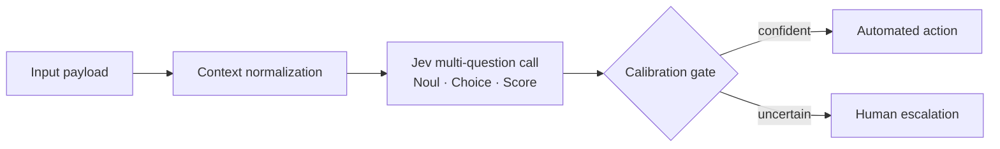

# System 1 AI Decision Engine with Jev & OpenRouter

A full-stack workbench for building **typed, calibrated decisions** with TypeSafe's Jev model (`typesafe/jev-1.14`) through OpenRouter's Decisions API. Instead of generating text, every call returns structured answers (a choice, a score, or a probability) that application code can act on directly.

Inspired by the Maven workshop *Build an AI Decision Engine with Jev: Beyond Chatbots*.

---

## Architectural overview

Chatbots are **System 2** machinery: an autoregressive model writes tokens one at a time, and your code then has to parse free-form prose back into something it can branch on. That is slow, costly, and hard to calibrate.

Jev is built for **System 1** decisions: fast, intuitive judgments inside an application. You send application *state* plus a set of typed *questions*, and Jev returns one answer per question in a single call, with no output tokens to generate:

| Primitive | Question it answers | Answer shape |
|-----------|---------------------|--------------|
| **`Noul`** | Yes or no? | `noul`: probability that the answer is `true` |
| **`Choice`** | Which of these labels? | `choice`, `confidence`, `probabilities` per label |
| **`Score`** | Where on this ordered scale? | `score` (probability-weighted level from 0), `confidence`, `probabilities` per level |

Because every answer carries a calibrated probability, the engine can apply a **calibration gate**: act automatically when confident, and hand the item to a human when it is not.

### Pipeline flow



```
Input Payload -> Context Normalization -> Jev Multi-Question Call -> Calibration Gating -> Automated Action
                                                                                    \-> Human Escalation
```

### Decision engines

| Engine | Endpoint | Questions | Gate |
|--------|----------|-----------|------|
| Ticket triage | `POST /api/v1/triage` | Choice: billing / technical / security / feature · Score: P4–P1 urgency · Noul: ambiguous? | Escalates when ambiguity > 0.40 **or** category confidence < 0.70 |
| Task router | `POST /api/v1/route` | Choice: target queue · Score: S–XL complexity · Noul: needs human judgment? | Sends to `human_review` when queue confidence < 0.65 or human-judgment probability > 0.50 |
| Transcript clipper | `POST /api/v1/clip` | Noul: standalone concept? · Score: hook potential 1–5 | Clips when standalone ≥ 0.60 and hook ≥ 3.5; flags 0.40–0.60 as borderline |
| Custom playground | `POST /api/v1/decide` | Any user-defined Choice / Score / Noul questions | Flags answers under a configurable confidence threshold (default 0.70) |

### Project layout

```
app/
├── main.py              # FastAPI app factory, static workbench at /
├── core/
│   ├── config.py        # Pydantic Settings (.env), mock-mode resolution, setup notice
│   ├── models.py        # Question, answer, request, and engine response schemas
│   └── client.py        # Async JevClient (httpx, retries, latency) + deterministic mock
├── engines/             # ticket_triage, task_router, transcript_clipper, custom_eval
├── api/routes.py        # REST endpoints
└── static/              # Tailwind + vanilla JS four-tab workbench
tests/                   # client, triage gate, and API contract tests
```

---

## Quickstart

Requires Python 3.11 or newer.

1. Set up a virtual environment:
   ```bash
   python -m venv venv && source venv/bin/activate
   ```
2. Install dependencies:
   ```bash
   pip install -r requirements.txt
   ```
3. Configure credentials: copy `.env.example` to `.env` (if it does not exist yet) and set `OPENROUTER_API_KEY` to your OpenRouter key.
4. Launch the application:
   ```bash
   uvicorn app.main:app --reload --port 8000
   ```
5. Open the workbench at <http://localhost:8000>. Interactive API docs are at <http://localhost:8000/docs>.

### Configuration

| Variable | Default | Purpose |
|----------|---------|---------|
| `OPENROUTER_API_KEY` | `your_openrouter_api_key_here` | OpenRouter API key |
| `OPENROUTER_DECISIONS_URL` | `https://openrouter.ai/api/alpha/decisions` | Decisions API endpoint |
| `JEV_MODEL` | `typesafe/jev-1.14` | Jev model ID (`~typesafe/jev-latest` tracks the newest release) |
| `PORT` | `8000` | Port the workbench is documented to run on |
| `MOCK_MODE` | `false` | `true` will answer every question locally without calling OpenRouter |

**Mock mode.** When `MOCK_MODE=true`, or when the API key is blank or still the placeholder, the engine will answer with a deterministic local simulator and print a `[SETUP NOTICE]` banner at startup. The header badge in the workbench shows `Mock Mode` or `Live API`, and `GET /api/v1/health` reports `mock_mode` and `mock_reason`. Mock answers come from word overlap between the state and each option's guidance, so they are plausible for demos but are not real model output.

---

## API documentation

### Health

```bash
curl http://localhost:8000/api/v1/health
```

```json
{
  "status": "ok",
  "model": "typesafe/jev-1.14",
  "mock_mode": true,
  "mock_reason": "placeholder_credentials",
  "decisions_url": "https://openrouter.ai/api/alpha/decisions"
}
```

### Ticket triage

```bash
curl -X POST http://localhost:8000/api/v1/triage \
  -H "Content-Type: application/json" \
  -d '{
        "subject": "Charged twice",
        "text": "My card was charged twice for invoice #4821. Please refund the duplicate payment.",
        "customer_tier": "pro",
        "channel": "email"
      }'
```

Response (mock mode; `answers` holds the raw typed answers and is trimmed here):

```json
{
  "outcome": "billing",
  "category": "billing",
  "confidence": 0.9983,
  "distribution": { "billing": 0.9983, "technical": 0.0004, "security": 0.0009, "feature": 0.0005 },
  "urgency": {
    "label": "P3 Medium",
    "level": 1,
    "expected_level": 1.4733,
    "confidence": 0.2937,
    "distribution": { "P4 Low": 0.2321, "P3 Medium": 0.2937, "P2 High": 0.243, "P1 Critical": 0.2312 }
  },
  "ambiguity_probability": 0.1689,
  "requires_human_escalation": false,
  "escalation_reasons": [],
  "latency_ms": 0.19,
  "model": "typesafe/jev-1.14",
  "mock_mode": true,
  "usage": { "input_tokens": 27, "output_tokens": 0, "cost": 0.0 },
  "answers": { "...": "..." }
}
```

### Custom decision

Question shapes follow the Decisions API: `choice` takes a `criteria` object of label → guidance, `score` takes a `criteria` array of levels from lowest to highest (`scale` is accepted as an alias), and `noul` takes optional `criteria` with `true` and `false` guidance.

```bash
curl -X POST http://localhost:8000/api/v1/decide \
  -H "Content-Type: application/json" \
  -d '{
        "state": "I was charged twice for my invoice and need a refund.",
        "questions": {
          "category": {
            "type": "choice",
            "instructions": "Categorize the ticket",
            "criteria": { "billing": "Invoices, payments, refunds", "technical": "Bugs, errors, crashes" }
          },
          "ambiguous": { "type": "noul", "instructions": "Is this request ambiguous or incomplete?" }
        },
        "confidence_threshold": 0.7
      }'
```

```json
{
  "answers": {
    "category": {
      "type": "choice",
      "choice": "billing",
      "confidence": 0.9776,
      "probabilities": { "billing": 0.9776, "technical": 0.0224 }
    },
    "ambiguous": { "type": "noul", "noul": 0.1562 }
  },
  "requires_human_escalation": false,
  "escalation_reasons": [],
  "latency_ms": 0.05,
  "model": "typesafe/jev-1.14",
  "mock_mode": true,
  "usage": { "input_tokens": 13, "output_tokens": 0, "cost": 0.0 }
}
```

Upstream errors are returned as `502` (OpenRouter returned an error) or `504` (timeout or network failure), with the upstream status in `detail.upstream_status`. The client will retry `429` and `5xx` responses with exponential backoff, honoring `Retry-After`.

---

## Testing

```bash
pytest
```

The suite runs fully offline. It covers request serialization, mock determinism, retry and error handling (via `httpx.MockTransport`), the triage calibration-gate boundaries, and the REST contracts through FastAPI's `TestClient`.
